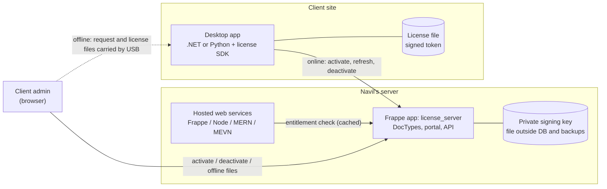

# Code-License: Decision Brief

| Field | Value |
|---|---|
| Version | 0.2 (draft) |
| Date | 2026-10-19 |
| Status | Conditionally approved; waiting on Phase 0 results and decisions D1–D3 |
| Council roles | Technical architect, skeptic, security reviewer |
| Changes from v0.1 | Navil's answers to Q1–Q8 incorporated. Decision changed from "validate first" to "build in stages" |

Related: [01-requirements.md](01-requirements.md) ·
[ADR-0001 License server on Frappe](adr/0001-license-server-on-frappe.md) ·
[ADR-0002 Token format and signing](adr/0002-license-token-format-and-signing.md)

---

## 1. Decision

**Build, in stages.** Confidence: **medium**.

- Build the license server as a custom Frappe app on Navil's server (ADR-0001). Ship one .NET
  SDK first and pilot it on one product with one client.
- **First, and in parallel, work on the loss that actually happened: leaked code.** A license
  system does not stop leaked source code from being reused (§3).

Why this changed from v0.1:

- There is now a stated, real loss: code was leaked and reused on other platforms.
- The license server must run on Navil's server, which rules out SaaS licensing services.
- Navil hosts the web services himself, so only two client SDKs are needed (.NET and Python).

---

## 2. What the answers established

These are facts as stated by Navil on 2026-10-19.

| Topic | Answer | Consequence |
|---|---|---|
| Desktop apps | .NET Framework, .NET Core, Python | Two SDKs. One .NET Standard 2.0 library covers .NET Framework and .NET Core (minimum framework version to be confirmed, N1); one Python library. |
| Web services and web apps | Frappe, Node, React, MERN, MEVN; hosted by Navil | No license SDK needed. Access is a per-client entitlement check on Navil's server. |
| Connectivity | Client sites are online or offline | Online activation and offline activation by file are both needed in v1. |
| License model | Per machine, perpetual, with a fixed expiry: 9999-12-31 for most clients, about 30 days for clients with unreliable payments, extended when they pay | One `expires_on` per license; an extension sets a new expiry. **Offline machines need a new license file for every extension.** |
| "Multi-license server" | A central server plus a client self-service portal: activate and deactivate machines, at most 3 resets per month | No on-prem floating-seat server is needed, because licensing is per machine. The reset rule needs a precise definition (D3). |
| Loss | "My service code is leaked and used in different platforms" | §3. **This is the most important answer.** |
| Expiry behaviour | Popup, then kill the application | Accepted at startup; challenged for industrial apps that are running (§4). |
| Scope | Navil's own products, plus extensions he writes for third-party platforms | Extensions run on someone else's server, so they have the same weakness as leaked source. |
| Hosting | Navil's server, as a custom Frappe app | ADR-0001. |

---

## 3. The leak: licensing does not fix it

A license check is just code. Anyone holding the source deletes the check, so leaked Frappe,
Node or Python source with a license check in it is still usable a few deleted lines later.
Licensing only helps when what you ship is hard to modify (compiled and obfuscated .NET,
compiled Python), or when the valuable logic stays on Navil's server.

The plan therefore has two tracks.

### Track 1: protect the code (Phase 0; do this first, it is cheap)

1. **Find the leak path.** Establish which product and version leaked, and how it could have
   left: Navil's own repositories or servers, a contractor or former employee, a client's
   server, or a third-party platform. The answer decides the rest of this track.
2. **Stop shipping readable source to machines Navil does not control.**
   - Hosted services: the code never leaves Navil's servers.
   - Desktop apps: ship compiled builds only. Use obfuscation for .NET. Compile Python with
     Nuitka or Cython rather than PyInstaller, whose bundles are easy to unpack. Verify the
     approach per app.
   - Extensions on third-party platforms: where the extension can be online, move the valuable
     logic behind an API on Navil's server and leave only a thin client on the platform.
3. **Watermark each client's build** with its customer ID and license ID, so a leaked copy can
   be traced to its source. A determined attacker can strip a watermark, so use several subtle
   marks.
4. **Contracts:** add IP and confidentiality clauses for clients, contractors and third-party
   partners. Get legal advice on taking down the copies already in use.
5. **If the leak came from inside:** tighten access to repositories and servers (who has
   access, deploy keys, revoking former staff).

### Track 2: licensing (Phases 1–3)

Controls who may run the software Navil distributes, on which machines, and until when.

---

## 4. Expiry behaviour: where I disagree

Navil's rule is: show a popup, then kill the application.

- **At startup:** agreed. If there is no valid license, show a popup offering Activate or Import
  license file, and exit if the license is not resolved.
- **While running, for apps that do not control equipment:** agreed, after saving the user's
  work.
- **While running, for apps that command robots, welding power sources, PLCs or scanners:** I
  recommend **not** killing the app mid-cycle.
  - Killing the orchestrating app mid-weld or mid-transfer can scrap the part, lose the cycle's
    data, or leave the cell needing manual recovery.
  - Safety itself belongs to the robot controller and the safety PLC. But the process and data
    losses are real, and the client will blame Navil for them.
  - **Recommended instead:** show the popup immediately, block any new cycle or job from
    starting, and exit when the current cycle ends or the app is idle.
- **Warn in advance**, from a configurable number of days before expiry, so a 30-day license
  never ends as a surprise.
- **Grace period:** configurable per license. Navil's stated rule implies 0 days. I recommend a
  default of 3 days to absorb payment delays, but this is a business decision (D2).
- **An unreachable license server never kills a running app.** Validity is checked locally,
  from the signed license.

The industrial-app behaviour is **Navil's decision (D1)**. Record it in the requirements
(FR-ENF-4) once it is made.

---

## 5. Architecture summary

- **An activated desktop app never needs the license server to run.** The server is only
  involved in activation, refresh, deactivation and the portal.
- **Tokens are ES256-signed JWS** (ADR-0002). The public keys are embedded in the SDKs.
- **Two SDKs:** .NET (netstandard2.0) in Phase 1, Python in Phase 2.
- **Hosted services:** each client gets a per-service API key, checked against the license
  server and cached locally (Phase 2).

---

## 6. Skeptic's remaining case

1. **The licensing track will not recover the leak that already happened**, and it will not
   prevent the next one unless Track 1 is done. The risk is that building a license server
   feels like progress on the leak when it is not.
2. **Some code is bypassable in minutes:** any Python app shipped as source, and any extension
   running on a third-party platform.
3. **Deactivating an offline machine cannot be verified.** A client can claim to deactivate it
   and keep using it. At 3 resets a month, that is up to 36 extra machines a year per license
   (see D3 and R-10). A portal deactivation of an online machine whose network is then blocked
   has the same weakness.
4. **Building the server means owning it permanently:** key custody, backups, Frappe upgrades
   and portal security. The burden is small but never goes away.

---

## 7. Decisions needed from Navil

| ID | Decision | Recommendation | Blocks |
|---|---|---|---|
| D1 | When a license expires while an industrial app is running: kill it immediately, or block new cycles and exit when idle? | Exit when idle | FR-ENF-4 |
| D2 | Default grace period after expiry | 3 days, overridable per license | FR-ENF, FR-LIC-1 |
| D3 | Reset rule: counted per license or per customer? Per calendar month or rolling 30 days? Are offline deactivations treated differently? | Per license, rolling 30 days. Offline deactivations limited to 1 per 30 days and flagged for Navil's review | FR-ACT-3, FR-OFF-4 |
| D4 | The leak path. This is a fact to establish, not a choice | Investigate first | Track 1 |

## 8. Open questions

| ID | Question | What it decides |
|---|---|---|
| N1 | What is the oldest .NET Framework version your apps target? | Whether built-in ECDSA is enough or a third-party crypto library is needed (ADR-0002) |
| N2 | How are the Python desktop apps distributed today: source, PyInstaller, Nuitka, other? | The code-protection approach |
| N3 | Which third-party platforms do your extensions run on, and are they online? | Whether extensions can move to an API |
| N4 | Do you run ERPNext for invoicing? | Phase 3: extending licenses automatically on payment |
| N5 | Roughly how many clients and machines now, and in 2 years? | Capacity planning; not expected to change the design |
| N6 | Do client contracts allow disabling the software on expiry? (Still open from v0.1) | Legal exposure |

---

## 9. Plan

All efforts are estimates for one developer and have not been validated.

| Phase | Scope | Effort | Exit criteria |
|---|---|---|---|
| 0 | Track 1 steps 1–3; decisions D1–D3; answers to N1–N2 | 2–4 days | Leak path known or bounded; D1–D3 recorded in the requirements |
| 1 | Frappe app MVP, .NET SDK, one product, tests | 3–5 weeks | Acceptance criteria in 01-requirements pass, including cross-language test vectors |
| Pilot | One product, one client, one online and one offline machine | 2–4 weeks | Zero wrongful lockouts; activations and resets follow the rules; the client admin can self-serve |
| 2 | Python SDK and packaging; hosted-service entitlement check; expiry reminder emails | 2–4 weeks | Requirements marked Phase 2 pass |
| 3 | Third-party extension licensing; ERPNext payment link; watermarking in CI; key-rotation drill | Sized after N3 and N4 | — |

## 10. Success metrics

- Every distributed install has a license and an activation on record.
- Zero client production stoppages caused by licensing.
- Navil can issue or extend a license in 5 minutes or less. A client admin can complete an
  offline activation in 10 minutes or less.
- No readable source is shipped to client or third-party machines (Track 1).
- A leaked build can be traced to a customer.

## 11. Stop or change-course criteria

- **The leak came from Navil's own repositories, servers or staff:** do Track 1 access control
  first. Licensing continues only for the distributed desktop apps.
- **The pilot produces a wrongful lockout** that is not root-caused and fixed within a week:
  stop the rollout.
- **Built-in ECDSA is not usable on the oldest required .NET Framework:** fall back to RSA or a
  crypto library (ADR-0002). This is a fallback, not a stop.
- **The Frappe app fails a security review of how the key is isolated:** move signing into a
  small separate signing service, and keep Frappe for the portal and the data.

---

## 12. Risk register

| ID | Risk | Impact | Likelihood | Mitigation |
|---|---|---|---|---|
| R-01 | A wrongful lockout stops client operations | High | Medium | Advance warnings, grace period, local verification, exit only at idle for industrial apps (D1) |
| R-02 | The signing key is compromised | Critical | Low | Key file outside the DB and backups; `kid` rotation; reissue plan (ADR-0002) |
| R-03 | The license check is bypassed | High (Python, extensions); Medium (.NET) | High | Track 1: compiled builds, server-side logic, watermarking |
| R-04 | A license-server outage affects clients | Medium | Medium | The server is never needed at runtime; only activation and refresh stop |
| R-05 | Machine fingerprints break (VM, hardware swap, reinstall) | Medium | High | Tolerant matching, 2 of 3 components (ADR-0003, pending) |
| R-06 | A Frappe upgrade breaks the license server | Medium | Medium | Pin the version; run the test suite before upgrading; dedicated site |
| R-07 | Legal exposure from killing software on expiry | High | Unknown | Contract clause (N6); advance warnings |
| R-08 | Scope grows into a billing system | Medium | Medium | Billing out of scope; ERPNext link only in Phase 3 |
| R-09 | Privacy exposure from data collected about client machines | Medium | Low | Store only hashed fingerprint components; set a retention period |
| R-10 | Fake offline or portal deactivations create unpaid machines | Medium | Medium | D3 limits; flag patterns for review; known limitation documented |
| R-11 | Licensing is mistaken for the fix to the code leak | High | High | Track 1 runs first, with its own exit criteria |
| R-12 | The 9999-12-31 expiry or timezones are mishandled | Medium | Medium | No TIMESTAMP columns or 32-bit epochs; explicit timezone rule; tests at the date boundary (NFR-7) |

## 13. Next artifacts

1. **Done in this revision:** [01-requirements.md](01-requirements.md) v0.1,
   [ADR-0001](adr/0001-license-server-on-frappe.md), [ADR-0002](adr/0002-license-token-format-and-signing.md).
2. Phase 0 leak findings, recorded as `docs/02-leak-investigation.md`.
3. ADR-0003: machine fingerprint and matching rule.
4. Test plan, with cross-language test vectors.
5. Phase 1 task graph.
