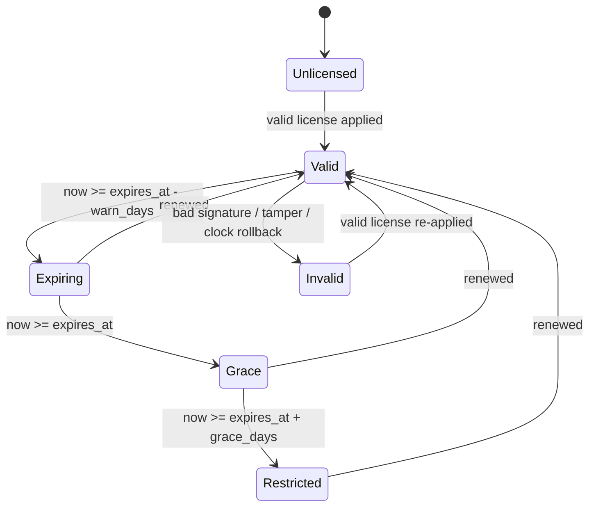

# Code-License: Decision Brief

| Field | Value |
|---|---|
| Version | 0.1 (draft) |
| Date | 2026-10-19 |
| Status | Awaiting answers to open questions Q1–Q8 |
| Council roles | Technical architect, skeptic, security reviewer |
| Source of requirements | `README.md` (two sentences; no issues or other specs exist) |

---

## 1. Decision

**Validate first.** Confidence: **medium**.

Do not build a general-purpose, multi-runtime licensing platform yet. Spend about one week
(estimate) answering the open questions, running one single-runtime spike, and evaluating
two off-the-shelf options. Then record the build-vs-buy decision as ADR-0001.

The reason: the README asks for software that "can never run without the active license".
That is only achievable for code Navil hosts. For code on client-controlled machines it is
not achievable, and the right design depends on facts we do not have yet: which products,
which runtimes, who hosts them, and whether client sites are online.

---

## 2. What the README asks for (interpreted)

> "This repo is to license server code, that includes stand alone desktop apps and
> multi-license server setup, which will be used for website and webservices for all clients
> which can never run without the active license, this license will be used to verify if the
> client have access to my services or not."

Candidate requirements (not yet confirmed):

| ID | Candidate requirement |
|---|---|
| CR1 | Standalone desktop apps do not operate fully without a valid license. |
| CR2 | Server deployments (websites, web services) do not operate without a valid license. |
| CR3 | A "multi-license server" issues and validates licenses for many clients and products. *Ambiguous; see Q4.* |
| CR4 | An entitlement check answers "does client X have access to service Y?" |
| CR5 | Applies to all clients. |

---

## 3. What decides the architecture: where the code runs

| Deployment | Who controls the machine | What "license" means in practice | Enforcement strength |
|---|---|---|---|
| Navil-hosted website / web service (SaaS) | Navil | Authentication plus a per-tenant entitlement (account status, plan, features, API key) | **Strong**: the client never has the code |
| Client-hosted server (Docker or VM on client infrastructure) | Client | Signed license plus periodic check-in from code the client runs | Weak to moderate |
| Desktop app, online | Client | Signed license plus activation plus lease renewal | Moderate |
| Desktop / HMI on an air-gapped plant network | Client | Signed offline license file; activation by request/response file | Weakest; cannot be revoked before it expires |

**Fact:** code on a machine the client controls can always be patched to skip the check.
For interpreted stacks (Python/Frappe, PHP, Node, Ruby) the client already has the source.
For .NET, decompile-and-patch tools (ILSpy, dnSpy) make it a modest effort. Obfuscation
raises the cost; it does not prevent the bypass.

**Realistic goal for client-hosted code:** make the honest path effortless, make overuse
visible, make bypass cost more than the license, and back it with a contract.

---

## 4. Skeptic's case: why we should not build this

1. **It does not differentiate.** Clients pay for the products, not the licensing. Every week
   spent here is a week not spent on those products.
2. **Mature options exist.** See §5, Option B. They need a fit check before anything is built.
3. **The stated goal cannot be met on client hardware.** A home-built system can give false
   confidence that it has been.
4. **A wrongful lockout can cost more than piracy.** A lockout caused by clock drift, a network
   card change, a VM migration or a license-server outage damages the client relationship. In
   an industrial cell it can stop a production line.
5. **No evidence of the problem yet.** We have no data on lost revenue, overuse or non-payment.
   If there are few clients and all are under contract, a contract plus invoicing may solve most
   of it.
6. **Each runtime costs extra.** Every runtime shipped (.NET, Node, Python, PHP) needs its own
   SDK, tests and hardening, and each one adds a place where the check can be bypassed.

**Strongest argument against:** licensing is worth at most the revenue it protects, and that
number is unknown.

---

## 5. Options

### Option A: signed license file only (no server)

- A vendor-side CLI signs a license (Ed25519 via JWS/PASETO, or ECDSA via the .NET
  `Standard.Licensing` library). The app verifies it offline with an embedded public key.
- Expiry, grace period and feature flags only. No activation limits, seat counting or revocation.
- Effort: days (estimate). Infrastructure: none.

### Option B: adopt an existing licensing service

- **Keygen CE**: self-hosted, free for commercial use. Source is under the Fair Core License,
  which permits self-hosting for your own products but not running a competing hosted
  licensing service. Requires PostgreSQL and Redis. Support is best-effort.
- **Cryptolens**: SaaS with a .NET SDK. Supports node-locked and floating licenses, offline
  license files, and an on-premise license server for offline floating seats.
- Effort: 1–2 weeks of integration (estimate). Costs: the operations burden (Keygen CE) or a
  subscription (Cryptolens). Lock-in: the vendor's license format and API.

### Option C: build our own license server and SDKs

- A modular monolith (ASP.NET Core or Node, with PostgreSQL) providing Ed25519-signed licenses,
  activation, lease renewal, revocation, an admin UI and an audit log.
- Effort: 6–12+ weeks to production quality (estimate, not validated), plus permanent ownership
  of key management, availability, and one SDK per runtime.

### Trade-offs

| Criterion | A: signed file | B: adopt service | C: build |
|---|---|---|---|
| Time to first useful result | Days | 1–2 weeks | 6–12+ weeks |
| Activation / seat limits | No | Yes | Yes (must be built) |
| Revocation | No (wait for expiry) | Yes (online clients) | Yes (online clients) |
| Air-gapped support | Yes | Yes (offline files / on-prem server) | Must be built |
| Operational burden | None | Low (SaaS) to medium (self-host) | High |
| Reversibility | High | Medium (vendor format) | Low (sunk cost) |
| Control over data / residency | Full | Self-host: full; SaaS: vendor | Full |

---

## 6. Recommendation

1. **Navil-hosted services:** do not build "licensing". Add tenant entitlements (account status,
   plan, feature flags, API keys) to the existing authentication layer. This is ordinary access
   control.
2. **Client-hosted and desktop software, phase 1:** use Option A for the first product. It
   delivers value in days with no infrastructure.
3. **Phase 2:** when activation limits, revocation or seat counting across many clients are
   needed, adopt Option B. Build Option C only if B fails a concrete requirement, for example
   data residency, air-gapped floating seats, or cost at scale.
4. **Keep the in-app check behind one interface** (for example `ILicenseProvider`). Moving from
   A to B, or from B to C, then changes one component instead of every app.
5. **Whichever option is chosen, we define the enforcement policy ourselves (§7).** No vendor
   default should decide how an HMI behaves when a license expires.

---

## 7. Enforcement policy (required for every option)

| State | Behaviour |
|---|---|
| Valid | Full function. |
| Expiring | Full function; warning shown to admin users. |
| Grace | Full function; prominent warning; vendor notified on the next check-in. |
| Restricted / Invalid / Unlicensed | A defined, reduced mode, for example: no new jobs, projects or configuration changes. Viewing and exporting existing data stays available. |

Rules that must not be broken:

- **Never stop a running process, job or machine cycle because of license state.** Evaluate the
  license at startup and at safe points only (job start, user login).
- **License logic must never touch safety functions:** PLC safety logic, robot safety
  configuration, emergency stops or interlocks.
- **Never hold client data hostage.** Export stays available in the reduced mode. This is a
  matter of trust, and likely a legal requirement too.
- **"Server unreachable" does not mean "license invalid".** Online clients keep a cached, signed
  lease that stays valid for a set number of days.
- **Clock rollback:** store the last-seen time locally, detect the clock moving backwards, and
  prefer server time whenever the client checks in.
- **Support override:** a short-lived, signed emergency code that can be read out over the
  phone to restore an air-gapped site.

---

## 8. License format and key management (for Options A and C)

- **Use a standard signed format** (JWS with EdDSA, PASETO v4.public, or `Standard.Licensing`).
  Do not invent our own cryptography or container format.
- **Claims:** `lic_id`, `kid`, `schema_version`, `product`, `edition`, `features[]`,
  `customer_id`, `seats`, `binding {type: machine|deployment|domain, value}`, `issued_at`,
  `not_before`, `expires_at`, `grace_days`, `lease_ttl`.
- **The private signing key is the most valuable secret.** If it leaks, anyone can mint valid
  licenses for every product. Keep it offline or in a KMS. Never put it in the repo, in CI
  variables or in logs.
- **Rotation:** every license carries a `kid`, and apps embed more than one public key so keys
  can be rotated. On compromise: rotate the key, ship an update, and reissue all licenses.
- **Machine binding:** match on several hardware identifiers with a tolerance, not one exact
  fingerprint. VMs, Docker and hardware replacement will break exact matching. Allow a limited
  number of self-service transfers.

---

## 9. Assumptions register

| ID | Assumption | Status | If wrong |
|---|---|---|---|
| A1 | Licenses are for Navil's own products, not a licensing service for third parties | Unverified | Keygen CE's license would forbid it; this becomes a product decision |
| A2 | At least one product is client-hosted or desktop | Unverified | Only entitlements in the auth layer are needed (§6.1) |
| A3 | The first target runtime is .NET (desktop/HMI) | Inferred from background | The spike moves to that product's runtime |
| A4 | Some client sites are offline or air-gapped | Unverified | Online activation alone may be enough |
| A5 | Clients number in the tens, not thousands | Unverified | Option B or C becomes necessary sooner |
| A6 | The main threat is honest overuse or non-renewal, not professional cracking | Unverified | Needs server-side value and stronger hardening |
| A7 | Client contracts allow software to be restricted when a license lapses | Unverified | Legal review before any enforcement ships |

---

## 10. Open questions (each answer changes the plan)

| ID | Question | What it decides |
|---|---|---|
| Q1 | Which products are licensed, in which runtime, and who hosts each one? | The §3 rows that apply; how many SDKs are needed |
| Q2 | Are client deployments online, intermittently online, or air-gapped? | Offline files vs online activation and leases |
| Q3 | What is the license model: per machine, per site, concurrent seats, or per feature module? Subscription, or perpetual plus annual maintenance (AMC)? | The claims schema; whether seat counting is needed |
| Q4 | Does "multi-license server" mean a central issuing server, an on-prem floating-license server at client sites, or both? | Whether Option A is enough; how complex B or C must be |
| Q5 | What is lost per unlicensed install, and have there been known incidents? | How much this is worth investing (§4.6) |
| Q6 | What must each industrial app do when its license expires? Do any client contracts constrain that? | Enforcement policy (§7); legal exposure |
| Q7 | Is this only for your own products, or do you also intend to offer licensing to others? | Scope; Keygen CE eligibility |
| Q8 | Where must the license server run (data residency), and will plant networks allow outbound calls? | Hosting; whether online checks are possible |

---

## 11. Risk register

| ID | Risk | Impact | Likelihood | Mitigation |
|---|---|---|---|---|
| R-01 | A wrongful lockout stops client operations | High | Medium | Grace period, cached lease, checks at safe points only, support override |
| R-02 | The signing key is compromised | Critical | Low | Offline key or KMS; `kid` rotation; reissue plan |
| R-03 | The client-side check is bypassed | Medium | High (interpreted code) | Keep valuable functions server-side; obfuscation only to raise cost; contract; usage audit |
| R-04 | A license-server outage becomes a client outage | High | Medium | Licenses verifiable offline; the server is never required at runtime |
| R-05 | Machine fingerprints break (VM, Docker, hardware swap) | Medium | High | Tolerant multi-identifier binding; limited self-service transfer |
| R-06 | Vendor lock-in or the vendor shuts down (Option B) | Medium | Low–medium | `ILicenseProvider` interface; Keygen source is available |
| R-07 | Legal or contract exposure from restricting software | High | Unknown | Contract clauses, advance notice, data export preserved; legal review |
| R-08 | Scope grows into a billing platform | Medium | Medium | Billing is out of scope; the license system only reads "paid" status |
| R-09 | Privacy exposure from check-in data sent by client sites | Medium | Medium | Send only license ID, machine hash, app version and timestamp; disclose it in the contract |

---

## 12. Validation plan

| Step | Effort (estimate) | Output |
|---|---|---|
| V1 | 0.5 day | Answers to Q1–Q8; this brief updated to v0.2 |
| V2 | 1–2 days | Spike in the first target runtime (below) plus a test report |
| V3 | 1 day | Keygen CE (run locally in Docker) and a Cryptolens trial, scored against a requirements matrix built from Q1–Q4 |
| V4 | 0.5 day | ADR-0001: build vs buy for the license server |

**V2 spike acceptance criteria:**

- A valid license puts the app in `Valid`. Changing a single byte puts it in `Invalid`.
- A license past expiry but within the grace period puts the app in `Grace`, with full function.
- A license past the grace period puts the app in `Restricted`. Work already in progress is not
  interrupted, and data export still works.
- Setting the system clock back beyond a threshold is detected and logged.
- Only the public key is in the app. The private key never enters the repo.
- Every state transition has a unit test.
- The check sits behind `ILicenseProvider`.

**Success metrics for the overall project:**

- Every client installation has a license on record.
- Zero client production stoppages caused by licensing.
- Issuing or renewing a license takes 5 minutes or less.
- Overuse is detectable for online installations.

---

## 13. Kill criteria

- **All products are Navil-hosted:** stop. Implement entitlements in the auth layer instead.
- **An Option B product meets every must-have requirement at acceptable cost:** do not build
  Option C.
- **No evidence of revenue at risk, and few clients, all under contract:** stop after Option A.
- **Enforcement cannot be made safe for an industrial app** without a risk of stopping
  production: for that product, limit enforcement to warnings and reporting.

---

## 14. Out of scope

- Billing, payments and invoicing.
- Content DRM.
- Anti-debugging or anti-tamper beyond off-the-shelf obfuscation.
- Any change to safety functions.

---

## 15. Next artifacts

1. This brief, v0.2, after Q1–Q8 are answered.
2. `docs/01-requirements.md`: confirmed requirements with acceptance criteria.
3. `docs/adr/0001-license-server-build-vs-buy.md`.
4. `docs/adr/0002-license-format-and-key-management.md`.
5. V2 spike code and its test report.

---

## Sources

- Keygen self-hosting documentation: https://keygen.sh/docs/self-hosting/
- Keygen, "All your licensing are belong to you" (Fair Source announcement): https://keygen.sh/blog/all-your-licensing-are-belong-to-you/
- Standard.Licensing on NuGet: https://www.nuget.org/packages/Standard.Licensing
- Cryptolens, "Floating licenses in an offline setting": https://cryptolens.io/2024/05/floating-licenses-in-an-offline-setting
- Cryptolens, "Offline license verifications": https://cryptolens.io/2024/07/offline-license-verifications

Vendor facts above were taken from vendor pages on 2026-10-19 and have not been tested hands-on.
V3 is where they get verified.
