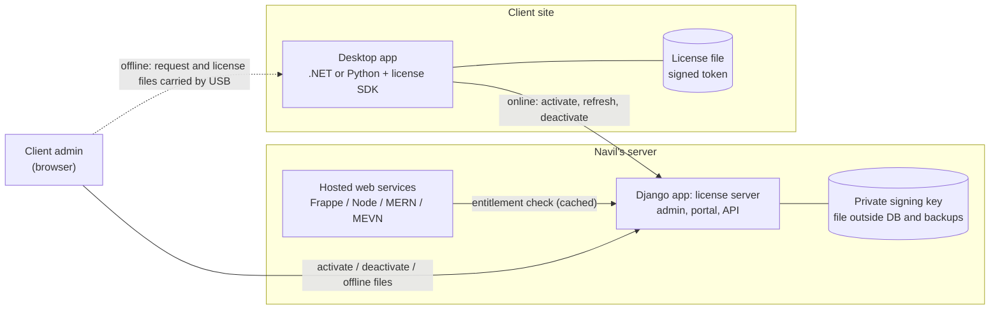

# Code-License: Decision Brief

| Field | Value |
|---|---|
| Version | 0.3 (draft) |
| Date | 2026-10-23 |
| Status | Conditionally approved; waiting on the leak path (D4) and confirmation of the repository layout (D6) |
| Council roles | Technical architect, skeptic, security reviewer |
| Changes in v0.3 | D1–D3 and D5 decided; N1–N4 and N6 answered. The license server moves from a Frappe app to a standalone Django application with no ERPNext integration (ADR-0004 supersedes ADR-0001). Phase 1 re-estimated from the task graph; separate extension track removed |
| Changes in v0.2 | Answers to Q1–Q8 incorporated; decision changed from "validate first" to "build in stages" |

Related: [01-requirements.md](01-requirements.md) ·
[03-test-plan.md](03-test-plan.md) ·
[04-phase1-task-graph.md](04-phase1-task-graph.md) ·
[ADR-0004 License server on Django](adr/0004-license-server-on-django.md) ·
[ADR-0002 Token format and signing](adr/0002-license-token-format-and-signing.md) ·
[ADR-0003 Machine fingerprint](adr/0003-machine-fingerprint.md) ·
[ADR-0001 (superseded)](adr/0001-license-server-on-frappe.md)

---

## 1. Decision

**Build, in stages.** Confidence: **medium**.

- Build the license server as a standalone Django application on Navil's server (ADR-0004).
  Ship one .NET SDK first and pilot it on one product with one client.
- **First, and in parallel, work on the loss that actually happened: leaked code.** A license
  system does not stop leaked source code from being reused (§3).

Why this changed from v0.1:

- There is now a stated, real loss: code was leaked and reused on other platforms.
- The license server must run on Navil's server, which rules out SaaS licensing services.
- Navil hosts the web services himself, so only two client SDKs are needed (.NET and Python).

---

## 2. What the answers established

These are facts as stated by Navil on 2026-10-19 and 2026-10-23.

| Topic | Answer | Consequence |
|---|---|---|
| Desktop apps | .NET Framework, .NET Core, Python | Two SDKs: one .NET library targeting net47 and netstandard2.0 covers .NET Framework 4.7+ and .NET Core (N1); one Python library. |
| Web services and web apps | Frappe, Node, React, MERN, MEVN; hosted by Navil | No license SDK needed. Access is a per-client entitlement check on Navil's server. |
| Connectivity | Client sites are online or offline | Online activation and offline activation by file are both needed in v1. |
| License model | Per machine, perpetual, with a fixed expiry: 9999-12-31 for most clients, about 30 days for clients with unreliable payments, extended when they pay | One `expires_on` per license; an extension sets a new expiry. **Offline machines need a new license file for every extension.** |
| "Multi-license server" | A central server plus a client self-service portal: activate and deactivate machines, at most 3 resets per month | No on-prem floating-seat server is needed, because licensing is per machine. Reset rule decided (D3, §7). |
| Loss | "My service code is leaked and used in different platforms" | §3. **This is the most important answer.** |
| Expiry behaviour | Popup, then kill the application. For industrial apps: exit when idle (D1) | Decided (§4). |
| Scope | Navil's own products, plus extensions he writes for third-party platforms | Clarified by N3: the "third parties" are the frameworks the products are built on (ERPNext; Syncfusion and Caliburn.Micro for .NET), not separate platforms. No separate extension track is needed. |
| .NET UI stack (N3) | WPF with Caliburn.Micro and Syncfusion | The SDK must bring no third-party dependencies and no UI of its own. Obfuscation must not rename Views or ViewModels (§3). |
| Python desktop apps (N2) | Shipped as source | The license check can be deleted in minutes. The Python SDK waits until these apps ship as compiled builds (§3). |
| Frappe apps on ERPNext (N3) | Custom apps extending ERPNext | Assumed hosted by Navil (Q1), so they need an entitlement check, not an SDK. |
| Oldest .NET Framework (N1) | 4.7 | ES256 with built-in crypto is expected to work (ADR-0002). The interop spike confirms it. |
| Contracts (N6) | Contracts explicitly allow disabling the software on expiry | Legal exposure (R-07) is lowered. |
| Hosting | Navil's server. Changed on 2026-10-23 from a Frappe app to a standalone Python web application on Django, with no ERPNext integration | ADR-0004, which supersedes ADR-0001. |

---

## 3. The leak: licensing does not fix it

A license check is just code. Anyone holding the source deletes the check, so leaked Frappe,
Node or Python source with a license check in it is still usable a few deleted lines later.
Licensing only helps when what you ship is hard to modify (compiled and obfuscated .NET,
compiled Python), or when the valuable logic stays on Navil's server.

The plan therefore has two tracks.

### Track 1: protect the code (Phase 0; do this first, it is cheap)

1. **Find the leak path.** Establish which product and version leaked, and how it could have
   left: Navil's own repositories or servers, a contractor or former employee, a client's
   server, or a third-party platform. The answer decides the rest of this track.
2. **Stop shipping readable source to machines Navil does not control.**
   - Hosted services: the code never leaves Navil's servers.
   - .NET desktop apps: obfuscate the assemblies that hold the valuable logic. **Do not rename
     Views or ViewModels:** Caliburn.Micro binds by naming convention, so renamed members break
     the UI. Keep valuable logic out of ViewModels so it can be obfuscated. (Spike: T0c.)
   - Python desktop apps are shipped as source today (N2). Compile them with Nuitka, or compile
     selected modules with Cython. PyInstaller bundles are easy to unpack, so don't rely on
     them. Until an app ships compiled, licensing it protects almost nothing. (Spike: T0b.)
   - Frappe apps on ERPNext: keep them on sites Navil hosts. Frappe runs apps from source, so a
     Frappe app installed on a client's server cannot be protected by licensing. Where a client
     must self-host, move the valuable logic behind an API on Navil's server.
3. **Watermark each client's build** with its customer ID and license ID, so a leaked copy can
   be traced to its source. A determined attacker can strip a watermark, so use several subtle
   marks.
4. **Contracts:** add IP and confidentiality clauses for clients, contractors and third-party
   partners. Get legal advice on taking down the copies already in use.
5. **If the leak came from inside:** tighten access to repositories and servers (who has
   access, deploy keys, revoking former staff).

### Track 2: licensing (Phases 1–3)

Controls who may run the software Navil distributes, on which machines, and until when.

---

## 4. Expiry behaviour (decided 2026-10-23)

| Situation | Behaviour |
|---|---|
| Startup with no valid license | Popup offering Activate or Import license file; exit if not resolved |
| Expiry while running; the app does not control equipment | Popup, save the user's work, exit |
| Expiry while running; the app commands robots, welding power sources, PLCs or scanners | Popup immediately, block new cycles and jobs, exit when the current cycle ends or the app is idle (D1) |
| Before expiry | Warnings from 7 days before (configurable) |
| After expiry | 30-day grace period with full function and a prominent warning (D2); overridable per license |
| License server unreachable | No effect; validity is checked locally, from the signed license |

The app decides what "idle" means and tells the SDK (FR-SDK-7). Because new cycles are blocked,
the app reaches idle as soon as its current cycle ends. The exception is an app running a
single continuous process with no cycle boundaries: it stops only at its next restart.

**A check on D2.** Grace only matters for licenses with a fixed expiry, and those are mostly the
30-day licenses for clients with unreliable payments. A 30-day grace on a 30-day license lets
such a client run for up to 60 days without paying. If that is not intended, set a shorter
grace on those licenses when issuing them. The admin form shows the effective end date (expiry
plus grace), so the effect is visible.

---

## 5. Architecture summary

- **An activated desktop app never needs the license server to run.** The server is only
  involved in activation, refresh, deactivation and the portal.
- **Tokens are ES256-signed JWS** (ADR-0002). The public keys are embedded in the SDKs.
- **Two SDKs:** .NET in Phase 1 (targets net47 and netstandard2.0; no third-party
  dependencies). Python in Phase 2, once the Python apps ship as compiled builds (§3).
- **Hosted services:** each client gets a per-service API key, checked against the license
  server and cached locally (Phase 2).

---

## 6. Skeptic's remaining case

1. **The licensing track will not recover the leak that already happened**, and it will not
   prevent the next one unless Track 1 is done. The risk is that building a license server
   feels like progress on the leak when it is not.
2. **Some code is bypassable in minutes:** any Python app shipped as source, and any extension
   running on a third-party platform.
3. **Deactivating an offline machine cannot be verified.** A client can claim to deactivate it
   and keep using it. At 3 resets a month, that is up to 36 extra machines a year per license
   (see D3 and R-10). A portal deactivation of an online machine whose network is then blocked
   has the same weakness. **D3 accepts this risk:** every deactivation counts the same, so the
   only mitigation is detecting suspicious patterns.
4. **Building the server means owning it permanently:** key custody, backups, Django upgrades
   and portal security. The burden is small but never goes away.
5. **Phase 1 is bigger than first estimated.** The task graph puts it at 28–40 working days
   (about 6–8 weeks), not 3–5 weeks. Moving from Frappe to Django adds about a day, because the
   portal and the scheduled job are now built by hand.
6. **Django is not in Navil's listed experience; Frappe is.** If Django is new to you, budget
   time to learn it. The estimates do not include that time.

---

## 7. Decisions

| ID | Decision | Status |
|---|---|---|
| D1 | What an industrial app does when its license expires while running | **Decided:** block new cycles, exit when idle |
| D2 | Default grace period after expiry | **Decided:** 30 days, overridable per license (see the check in §4) |
| D3 | Reset rule | **Decided:** 3 resets per license; every deactivation counts the same, whether online, offline or from the portal. **Assumed, to confirm:** the window is a rolling 30 days, not a calendar month, so a client cannot use 3 resets at the end of one month and 3 more at the start of the next |
| D4 | How the code leaked (a fact, not a choice) | **Open; highest priority.** Also: are any Frappe or ERPNext apps installed on servers Navil does not control? |
| D5 | ERPNext integration and server framework | **Decided:** no ERPNext integration. The license server is a standalone Python web application on Django (ADR-0004). License extensions stay manual, in the Django admin |
| D6 | Repository layout | **Proposed:** one repository (layout in [04-phase1-task-graph.md](04-phase1-task-graph.md)). Applies unless Navil objects |

## 8. Open questions

| ID | Question | Status |
|---|---|---|
| N1 | Oldest .NET Framework version | **Answered:** 4.7 |
| N2 | How the Python desktop apps are distributed | **Answered:** as source (consequences in §3) |
| N3 | Third-party platforms | **Answered:** ERPNext for Frappe; Syncfusion and Caliburn.Micro for .NET |
| N4 | ERPNext for invoicing | Resolved by D5: no ERPNext integration |
| N5 | Number of clients and machines, now and in 2 years | Open; not blocking |
| N6 | Do contracts allow disabling the software on expiry? | **Answered:** yes, stated explicitly in the contract |

---

## 9. Plan

All efforts are estimates for one developer and have not been validated.

| Phase | Scope | Effort | Exit criteria |
|---|---|---|---|
| 0 | Leak investigation (T0a); Nuitka spike (T0b); obfuscation spike (T0c); D4 and D6 | 3–5 days | Leak path known or bounded; D6 confirmed |
| 1 | Tasks T1–T13 in [04-phase1-task-graph.md](04-phase1-task-graph.md): Django server, .NET SDK, sample app, tests, deployment | 28–40 working days (about 6–8 weeks; excludes Django learning time) | Pilot entry criteria in [03-test-plan.md](03-test-plan.md) met |
| Pilot | One product, one client, one online and one offline machine | 2–4 weeks | Zero wrongful lockouts; activations and resets follow the rules; the client admin can self-serve |
| 2 | Python SDK, **only once T0b shows the Python apps can ship compiled**; hosted-service entitlement check; expiry reminder emails | 2–4 weeks | Requirements marked Phase 2 pass |
| 3 | Watermarking builds in CI; key-rotation drill | 3–5 days | A watermark is traced back from a test leak; a key rotation completes on a test client |

## 10. Success metrics

- Every distributed install has a license and an activation on record.
- Zero client production stoppages caused by licensing.
- Navil can issue or extend a license in 5 minutes or less. A client admin can complete an
  offline activation in 10 minutes or less.
- No readable source is shipped to client or third-party machines (Track 1).
- A leaked build can be traced to a customer.

## 11. Stop or change-course criteria

- **The leak came from Navil's own repositories, servers or staff:** do Track 1 access control
  first. Licensing continues only for the distributed desktop apps.
- **The pilot produces a wrongful lockout** that is not root-caused and fixed within a week:
  stop the rollout.
- **Built-in ECDSA is not usable on the oldest required .NET Framework:** fall back to RSA or a
  crypto library (ADR-0002). This is a fallback, not a stop.
- **The Python apps cannot be built with Nuitka or Cython (T0b):** do not build the Python SDK.
  Host those apps instead, or accept that they are unprotected.
- **The key isolation fails a security review:** move signing into a separate signing process
  running as its own OS user, and keep the Django app for the portal and the data.

---

## 12. Risk register

| ID | Risk | Impact | Likelihood | Mitigation |
|---|---|---|---|---|
| R-01 | A wrongful lockout stops client operations | High | Medium | Advance warnings, grace period, local verification, exit only at idle for industrial apps (D1) |
| R-02 | The signing key is compromised | Critical | Low | Key file outside the DB and backups; `kid` rotation; reissue plan (ADR-0002) |
| R-03 | The license check is bypassed | High (Python shipped as source); Medium (.NET) | High | Track 1: compiled builds, server-side logic, watermarking |
| R-04 | A license-server outage affects clients | Medium | Medium | The server is never needed at runtime; only activation and refresh stop |
| R-05 | Machine fingerprints break (VM, hardware swap, reinstall) | Medium | High | Tolerant matching (ADR-0003); Navil's admin deactivations do not use up the client's resets (FR-ACT-6) |
| R-06 | A Django or dependency upgrade breaks the license server | Medium | Low | Pin Django 5.2 LTS and every dependency; run the test suite before upgrading |
| R-07 | Legal exposure from killing software on expiry | High | Low | The contract explicitly allows it (N6); advance warnings; 30-day grace |
| R-08 | Scope grows into a billing system | Medium | Medium | Billing and ERPNext integration out of scope (D5) |
| R-09 | Privacy exposure from data collected about client machines | Medium | Low | Store only hashed fingerprint components; set a retention period |
| R-10 | Fake offline or portal deactivations create unpaid machines | Medium | Medium | **Accepted (D3).** Detection only: flag licenses that hit the reset limit in consecutive windows, and activations refreshing from two machines (FR-ACT-7) |
| R-11 | Licensing is mistaken for the fix to the code leak | High | High | Track 1 runs first, with its own exit criteria |
| R-12 | The 9999-12-31 expiry or timezones are mishandled | Medium | Medium | No TIMESTAMP columns or 32-bit epochs; explicit timezone rule; tests at the date boundary (NFR-7) |
| R-13 | The SDK's dependencies clash with the host app's (binding-redirect failures on .NET Framework) | Medium | Medium | No third-party runtime dependencies in the SDK, enforced in CI (FR-SDK-6) |
| R-14 | Obfuscation breaks Caliburn.Micro's convention-based binding | Medium | High if unmanaged | Never rename Views or ViewModels; obfuscate only the logic assemblies (T0c) |
| R-15 | The private signing key is lost (it is excluded from routine backups) | High | Low | Encrypted offline copies in two places, made at the key ceremony (T12) |
| R-16 | Django is new to the developer | Medium | Unknown | Conventional project layout; lean on the Django admin; time-box the learning. The estimates exclude it |

## 13. Next artifacts

1. **Done in v0.3:** [01-requirements.md](01-requirements.md) v0.2,
   [ADR-0003](adr/0003-machine-fingerprint.md), [ADR-0004](adr/0004-license-server-on-django.md),
   [03-test-plan.md](03-test-plan.md), [04-phase1-task-graph.md](04-phase1-task-graph.md).
2. Phase 0 leak findings, recorded as `docs/02-leak-investigation.md` (T0a).
3. Results of the T1 interop spike. ADR-0002 then becomes Accepted, or falls back to RS256.
