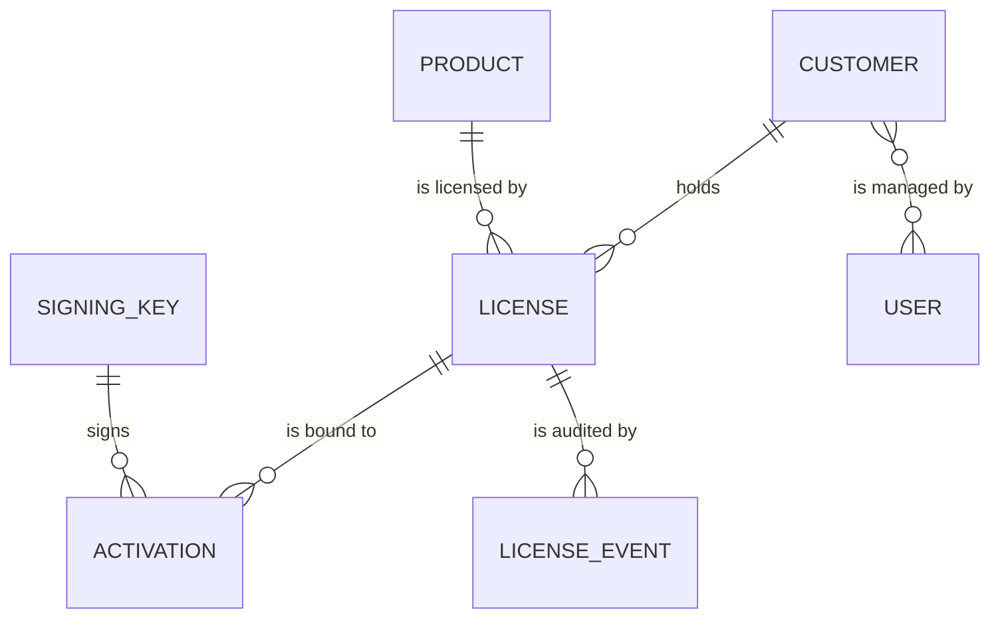
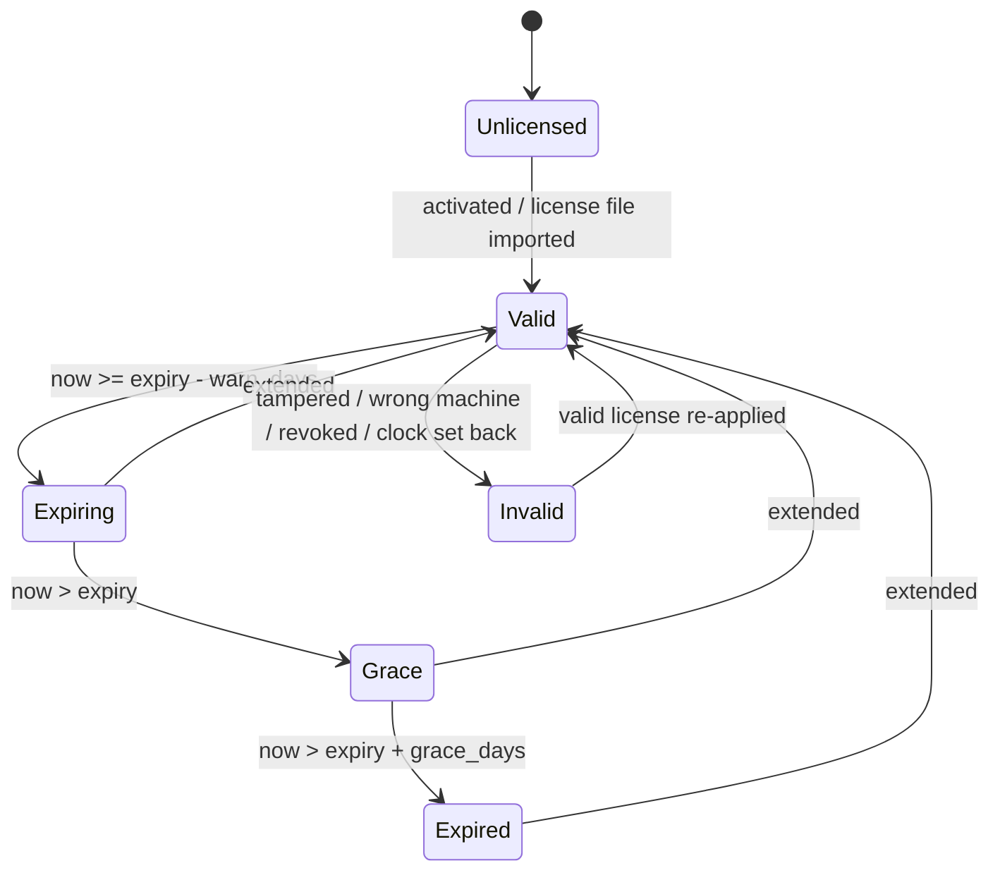

# Code-License: Requirements

| Field | Value |
|---|---|
| Version | 0.2 (draft) |
| Date | 2026-10-23 |
| Status | Draft. D1–D3 and D5 decided on 2026-10-23; the license server is a Django application (ADR-0004). The rolling 30-day reset window is an assumption to confirm |
| Scope | Phase 1 unless a requirement is marked otherwise |

## 1. Scope

| In scope for Phase 1 | Later phases | Out of scope |
|---|---|---|
| License server (Django application) | Python SDK (Phase 2, once the Python apps ship compiled) | Billing and payments |
| Client portal | Entitlement checks for hosted services (Phase 2) | Floating or concurrent seats |
| Online and offline activation | Expiry reminder emails (Phase 2) | On-prem license server |
| .NET SDK | Watermarking builds in CI (Phase 3) | Anti-debugging and DRM |
| Enforcement policy | Key-rotation drill (Phase 3) | ERPNext integration (D5); any change to safety functions |

## 2. Actors

| Actor | Responsibilities |
|---|---|
| Navil (vendor admin) | In the Django admin: issues, extends, suspends and revokes licenses; manages products and signing keys |
| Client admin (portal user) | Views their licenses; activates and deactivates machines; exchanges offline files |
| Desktop app with SDK | Activates, refreshes, verifies the license, and enforces the policy |
| Hosted service (Phase 2) | Checks whether a client is entitled to use it |

## 3. Domain model (Django models)

| Model | Purpose | Key fields |
|---|---|---|
| `Customer` | A client | `name`, `email`, `portal_users` (many-to-many to Django's `User`) |
| `Product` | A product that can be licensed | `product_code` (unique; used in tokens), `name`, `platform` (.NET desktop / Python desktop / Hosted service), `is_industrial` (selects the FR-ENF-4 behaviour), `default_grace_days` (30, per D2), `default_warn_days` (7), `features` (JSON list) |
| `License` | The right to run one product on up to N machines | `license_key_hash` (the key is shown once, then only its hash is kept), `customer`, `product`, `max_activations` (default 1), `expires_on` (`DateField`; 9999-12-31 means perpetual), `grace_days`, `warn_days`, `status` (Active / Suspended / Revoked), `features`, `notes` |
| `Activation` | One machine bound to a license | `license`, `fingerprint_hashes` (JSON), `machine_label`, `mode` (Online / Offline), `status` (Active / Deactivated), `activated_at`, `deactivated_at`, `deactivation_source` (App / Portal / Offline code / Admin), `last_refresh_at`, `app_version`, `kid` |
| `SigningKey` | Metadata and public half of a signing key | `kid`, `algorithm` (ES256), `public_key_pem`, `status` (Active / Retired). **The private key is never stored in the database.** |
| `LicenseEvent` | Append-only audit log | `license`, `activation`, `event_type`, `actor`, `source` (Portal / API / Admin), `payload` (JSON), `created_at` |

Resets are counted from the deactivations recorded on `Activation` within the reset window,
rather than kept in a separate counter. That keeps a single source of truth.

## 4. Functional requirements

Each requirement is followed by its acceptance criteria (AC).

### Issuing licenses (FR-LIC)

- **FR-LIC-1** Navil can issue a license for a customer and a product, setting
  `max_activations`, `expires_on`, `grace_days` and `warn_days`.
  - AC: the license key is displayed once, when the license is created. It is stored as a hash.
    An `Issued` event is logged.
  - AC: the form shows the effective end date (expiry plus grace), so a long grace on a short
    license is visible when it is issued.
- **FR-LIC-2** A perpetual license has `expires_on` = 9999-12-31.
  - AC: a 9999-12-31 license verifies as Valid on the server and in the .NET SDK, with no
    overflow. It is stored in a DATE or DATETIME column, never TIMESTAMP.
- **FR-LIC-3** Navil can extend a license by changing `expires_on`.
  - AC: the next refresh from an online machine returns a token with the new expiry. The portal
    offers an updated license file for each active offline activation. An `Extended` event is
    logged with the old and new dates.
- **FR-LIC-4** Navil can suspend or revoke a license.
  - AC: new activations are rejected. A refresh returns a revoked status, and the SDK moves to
    Invalid.
  - Known limitation (accepted): a machine that never refreshes keeps running until its expiry.

### Activation (FR-ACT)

- **FR-ACT-1** Online activation. The SDK sends the license key, product code, hashed
  fingerprint components, machine label and app version.
  - AC: if the license is Active and not expired, the product matches, and the active
    activations are fewer than `max_activations`, the server returns a signed token bound to
    the fingerprint and records the activation.
  - AC: otherwise it returns a structured error code: `LICENSE_NOT_FOUND`, `PRODUCT_MISMATCH`,
    `EXPIRED`, `LIMIT_REACHED` or `SUSPENDED`.
  - AC: either way, an event is logged.
- **FR-ACT-2** Re-activating the same machine is idempotent.
  - AC: the same fingerprint gets a fresh token and uses up neither a seat nor a reset.
- **FR-ACT-3** Deactivating a machine frees its seat and counts as one reset against that
  license. Every deactivation the client makes counts the same, whether from the app, the
  portal or an offline code (D3). The limit is 3 per license in any rolling 30 days (the window
  is assumed; to confirm).
  - AC: a 4th deactivation within 30 days is rejected with `RESET_LIMIT_REACHED`, together with
    the remaining count and the date the next reset becomes available.
  - Known limitation: after a portal deactivation, an online machine only learns of it at its
    next refresh.
- **FR-ACT-4** Activation, refresh and deactivation endpoints are rate-limited per IP address and
  per license key. The counters live in a cache shared by all worker processes: Django's
  database cache, so no Redis is needed (ADR-0004).
  - AC: too many failed attempts on one key in one hour temporarily block that key, and the
    block is logged.
- **FR-ACT-5** When the server is reachable, an online app refreshes at startup and every
  24 hours (configurable).
  - AC: an unreachable server causes no change in license state.
- **FR-ACT-6** Navil can deactivate an activation from the Django admin without using up one of the
  client's resets. This covers support cases such as a motherboard replacement (ADR-0003).
  - AC: the deactivation is logged with a reason, and the client's remaining reset count does
    not change.
- **FR-ACT-7** The server flags possible misuse for Navil's review: a license that hits the reset
  limit in two consecutive windows, and an activation that refreshes from two different machine
  labels within 24 hours.
  - AC: both cases appear in the daily report (NFR-5).

### Offline activation (FR-OFF)

- **FR-OFF-1** The SDK writes an offline request file containing the license key, product code,
  fingerprint hashes, a nonce and the app version.
- **FR-OFF-2** The client admin uploads the request in the portal. The server applies the
  FR-ACT-1 rules and returns a license file to download.
  - AC: imported on the requesting machine, the file is Valid. The same file on another machine
    is Invalid because of the fingerprint mismatch.
- **FR-OFF-3** After an extension, the portal offers an updated license file for each active
  offline activation.
- **FR-OFF-4** For offline deactivation, the SDK removes the license and displays a deactivation
  code, which the client admin enters in the portal.
  - AC: the server confirms the code belongs to that activation (license ID, fingerprint, nonce,
    checksum) and counts it as one reset, the same as any other deactivation (D3).
  - Known limitation: the server cannot prove the machine stopped using the license.

### Verification in the SDK (FR-SDK)

- **FR-SDK-1** The SDK verifies the signature using public keys embedded in the SDK, selected by
  `kid`. Only ES256 is accepted (ADR-0002).
  - AC: a token with one byte changed is Invalid. A token with `alg` none or HS256 is Invalid. A
    token with an unknown `kid` is Invalid.
- **FR-SDK-2** The SDK checks that the product code matches. It checks the fingerprint with the
  ADR-0003 rule: at least 2 of 3 components match, and the SMBIOS UUID must match whenever the
  activation recorded a valid one.
  - AC: with only MachineGuid or only the disk serial changed, the token is Valid. With the
    SMBIOS UUID changed, or with any two components changed, it is Invalid.
- **FR-SDK-3** The SDK computes the license state (§5) from the token's claims and the local
  UTC clock.
- **FR-SDK-4** The SDK detects the clock being set back. It stores the last time it saw; if the
  current UTC time is earlier than that by more than the tolerance (default 2 hours), the
  license is Invalid until the next online refresh or until a newer license file is imported.
- **FR-SDK-5** Apps use one interface (for example `ILicenseProvider`, with `GetState`,
  `Activate`, `Refresh`, `CreateOfflineRequest`, `ImportLicenseFile`, `Deactivate` and a
  `StateChanged` event). Apps never call the server directly.
- **FR-SDK-6** The .NET SDK multi-targets `net47` and `netstandard2.0`, so one package serves
  .NET Framework 4.7+ and .NET Core / .NET 5+. Microsoft recommends .NET Framework 4.7.2 or later
  for consuming netstandard2.0 libraries; targeting `net47` directly avoids that problem on 4.7
  and 4.7.1.
  - AC: the package has **no third-party runtime dependencies**. Host apps (Syncfusion,
    Caliburn.Micro and others) bring their own dependency versions, and on .NET Framework a clash
    shows up as binding-redirect failures. A CI check enforces this.
- **FR-SDK-7** The SDK core has no UI. The app shows the popup and the warnings (in WPF apps, a
  Caliburn.Micro window) and tells the SDK whether it is idle. The SDK raises state changes and
  reports whether the app must block new cycles or exit.
  - AC: the sample Caliburn.Micro app (T10) shows the popup and the warnings, blocks a new cycle,
    and exits at idle.

### Enforcement (FR-ENF)

- **FR-ENF-1** At startup, if the state is Unlicensed, Expired or Invalid, the app shows a popup
  offering **Activate**, **Import license file** and **Exit**. The app exits if the license is
  not resolved. (Navil's rule.)
- **FR-ENF-2** From `warn_days` before expiry (default 7), the app shows a warning at startup and
  once a day.
- **FR-ENF-3** If the license reaches Expired (after grace) or Invalid while the app is running,
  and the product is not industrial: show the popup, save the user's work, then exit.
- **FR-ENF-4** If the license reaches Expired or Invalid while the app is running, and the
  product is industrial (D1): show the popup immediately, block new cycles and jobs, and exit
  when the app reports it is idle.
  - AC: when the license expires during a simulated cycle, that cycle finishes, the next cycle
    start is refused with a license message, and the app exits once idle (TS-18).
- **FR-ENF-5** License logic never runs inside a motion or cycle loop, and never stops or alters
  a safety function.
- **FR-ENF-6** An unreachable server never changes the license state.

### Portal (FR-PRT)

- **FR-PRT-1** A client admin sees only their own customer's licenses: product, expiry,
  activations, and resets used and remaining.
  - AC: a permission test shows a user of customer A cannot read or act on customer B's records.
- **FR-PRT-2** A client admin can deactivate a machine, upload an offline request, download
  license files and enter offline deactivation codes.
- **FR-PRT-3** Navil's admin login requires two-factor authentication (`django-otp`, ADR-0004).
  Portal logins are rate-limited with the FR-ACT-4 mechanism. Two-factor login for portal users
  is optional in Phase 1.

### Audit (FR-AUD)

- **FR-AUD-1** Every issue, extension, suspension, activation, deactivation, refresh, and every
  rejected attempt writes a License Event.
  - AC: portal users cannot edit or delete events.

### Hosted services (FR-HST, Phase 2)

- **FR-HST-1** A hosted service checks the client's entitlement (customer and service) by API
  key against the license server. It caches the result locally for about 10 minutes. If the
  server is down, cached entries stay valid for up to 24 hours.
  - AC: an expired entitlement returns HTTP 403 with `LICENSE_EXPIRED`, and the web app shows a
    license-expired page.

## 5. License state machine

| State | App behaviour |
|---|---|
| Valid | Full function |
| Expiring | Full function, plus a warning (FR-ENF-2) |
| Grace | Full function, plus a prominent warning |
| Expired / Invalid / Unlicensed | Popup, then exit (FR-ENF-1/3/4) |

## 6. Non-functional requirements

- **NFR-1 Availability.** If the license server is down, only new activations, refreshes and the
  portal are affected. Running apps and apps already activated are not.
- **NFR-2 Security.**
  - The private key is a file on the host, mounted read-only into the app container. It is not
    in the database, the Docker image, the repository or the backup set. It has permissions 600,
    is readable only by the app's user, and its path comes from an environment variable.
  - The key is never in git, CI or logs.
  - Because the key is excluded from routine backups, it is backed up separately: encrypted,
    offline, in two locations, at the key ceremony (T12). Losing it would force a key rotation
    and new SDK builds for every client.
  - SDK release builds never embed a test key (a `kid` starting with `test-`). A CI check
    enforces this.
  - HTTPS only. Only ES256 is accepted. Rate limits as in FR-ACT-4.
- **NFR-3 Privacy.** Collect only hashed fingerprint components, the machine label, the app
  version, timestamps, and the IP address of online calls. Set a retention period for events (to
  be decided).
- **NFR-4 Backup.** Back up the database daily (`pg_dump`), and test a restore once before the
  pilot.
- **NFR-5 Observability.** A daily job reports licenses expiring within N days, rejected attempts
  and the misuse flags from FR-ACT-7. The job is a Django management command run by a systemd
  timer or cron. Server errors are logged and emailed to Navil (Django's `ADMINS` setting).
- **NFR-6 Compatibility.** The token schema carries a version (`ver`). The SDK rejects an unknown
  major version and tells the user to update the application.
- **NFR-7 Dates.**
  - All token times are UTC.
  - A license expires at 23:59:59 on `expires_on` in the server's configured timezone, converted
    to UTC in the token.
  - Tests cover 9999-12-31 and the moment of expiry at the day boundary.
- **NFR-8 Interoperability.** Test vectors signed by the server (Python) are verified in CI by
  the .NET SDK on .NET Framework (oldest version from N1) and on .NET 8, and by the Python SDK in
  Phase 2.

## 7. Next artifacts

Written alongside this version: [ADR-0003](adr/0003-machine-fingerprint.md),
[ADR-0004](adr/0004-license-server-on-django.md), [03-test-plan.md](03-test-plan.md) and
[04-phase1-task-graph.md](04-phase1-task-graph.md). This document is next updated after the T1
interop spike.
