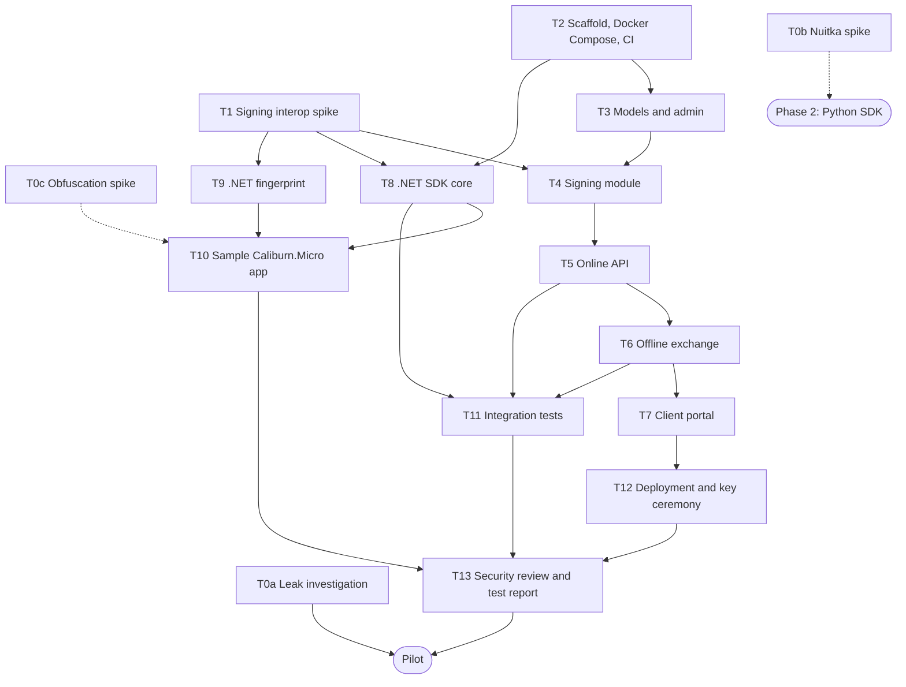

# Code-License: Phase 1 Task Graph

| Field | Value |
|---|---|
| Version | 0.1 (draft) |
| Date | 2026-10-23 |
| Status | Draft |
| Assumptions | One developer. Estimates are in working days, have not been validated, and exclude Django learning time (R-16) |
| Related | [Decision brief](00-decision-brief.md) · [Requirements](01-requirements.md) · [Test plan](03-test-plan.md) |

## 1. Repository layout (D6, proposed)

```
server/          Django project: the license server
sdk/dotnet/      .NET SDK, its tests, and the sample Caliburn.Micro app
sdk/python/      Python SDK (Phase 2)
test-vectors/    Shared fixtures (test keys only)
docs/            Decision brief, requirements, ADRs, plans, reports
```

**Why one repository:** the test vectors sit next to both the server and the SDKs. A change to
the token format is then tested on both sides in the same pull request. Split the repository
later if the SDKs need their own release cycles.

## 2. Dependency graph



Dashed arrows mean "informs", not "blocks".

## 3. Tasks

| ID | Task | Depends on | Days | Done when |
|---|---|---|---|---|
| T0a | Leak investigation | — | 1–2 | `docs/02-leak-investigation.md` records the leak path, or what was ruled out |
| T0b | Nuitka build spike on one Python desktop app | — | 1–2 | The app builds and runs compiled, or the blockers are listed |
| T0c | Obfuscation spike on one Caliburn.Micro app | — | 1 | The app runs obfuscated, and the rename exclusions are documented |
| T1 | Signing interop spike | — | 1–2 | A token signed in Python verifies on .NET Framework 4.7 and on .NET 8 with no third-party packages. The first test vectors are committed. ADR-0002 is Accepted or falls back to RS256 |
| T2 | Repository layout, Django project, Docker Compose, CI | D6 | 2 | `docker compose up` serves the admin locally. CI runs the server tests on Linux and the SDK tests on Windows. Secret scanning is on |
| T3 | Models, migrations, Django admin, permissions | T2 | 2–3 | The six models have admin screens. Portal users see only their own customer (TS-20) |
| T4 | Signing module and key loading | T1, T3 | 1–2 | Tokens are signed with the key file at the configured path. The key is never read from the database. The vectors pass |
| T5 | Online API: activate, refresh, deactivate | T4 | 3–4 | The activation rules, reset window, rate limits and events work. TS-05 to TS-09 pass at server level |
| T6 | Offline exchange | T5 | 2–3 | Request files, license files and deactivation codes work, and replayed nonces are rejected. TS-10 to TS-12 pass |
| T7 | Client portal | T6 | 4–5 | The FR-PRT pages work. TS-20 passes |
| T8 | .NET SDK core | T1, T2 | 4–6 | `ILicenseProvider`, verification, the state machine, the clock check, the online client and offline files all work. Multi-targets net47 and netstandard2.0 with no third-party dependencies. The vectors pass on both targets |
| T9 | .NET fingerprint | T1 | 2–3 | The ADR-0003 components are read without admin rights on a physical PC, a VM and a VM clone. ADR-0003 is Accepted |
| T10 | Sample WPF / Caliburn.Micro app | T8, T9 | 2 | The popup, warnings, simulated cycle and exit at idle work. TS-16 to TS-19 pass |
| T11 | Integration tests in CI | T5, T6, T8 | 2–3 | The net8.0 SDK passes against the server running in Docker Compose, with a fake fingerprint |
| T12 | Deployment and key ceremony | T7 | 2–3 | The production stack is up with TLS. The production key is generated offline, mounted read-only, and has encrypted copies in two places. Admin two-factor login is on. The daily job runs. A restore has been tested (TS-22, TS-24, TS-26) |
| T13 | Security review and test report | T10, T11, T12 | 1–2 | The checklist is done and `docs/reports/phase1-test-report.md` is written |

**Totals:** Phase 0 (T0a–T0c) takes 3–5 days. Phase 1 (T1–T13) takes 28–40 days.

## 4. Suggested order for one developer

1. T0a, T0b, T0c (Phase 0).
2. T1: the cheapest test of the highest technical risk, which is cross-language signatures on
   .NET Framework 4.7.
3. T2, T3, T4, T5: the server, through the online API.
4. T8, T9: the SDK. With T5 already done, integration can start straight away.
5. T6, T7, T10, T11, T12, T13.

## 5. Human checkpoints

- **Before T12 generates the production signing key:** Navil is present and approves.
- **Before the first install at a client.**
- **Before a licensed industrial app runs on a production cell:** only after TS-18 has passed
  on a non-production cell or a simulator.

## 6. Stop conditions

- **T1:** if ES256 cannot be verified on .NET Framework 4.7 without third-party packages, switch
  to RS256 (the ADR-0002 fallback) and repeat T1. If RS256 fails too, stop and re-plan.
- **T9:** if the fingerprint components cannot be read without admin rights, stop and revise
  ADR-0003 before starting T10.
- **T0a:** if the leak came from inside, Track 1 access control comes first (decision brief
  §11).
